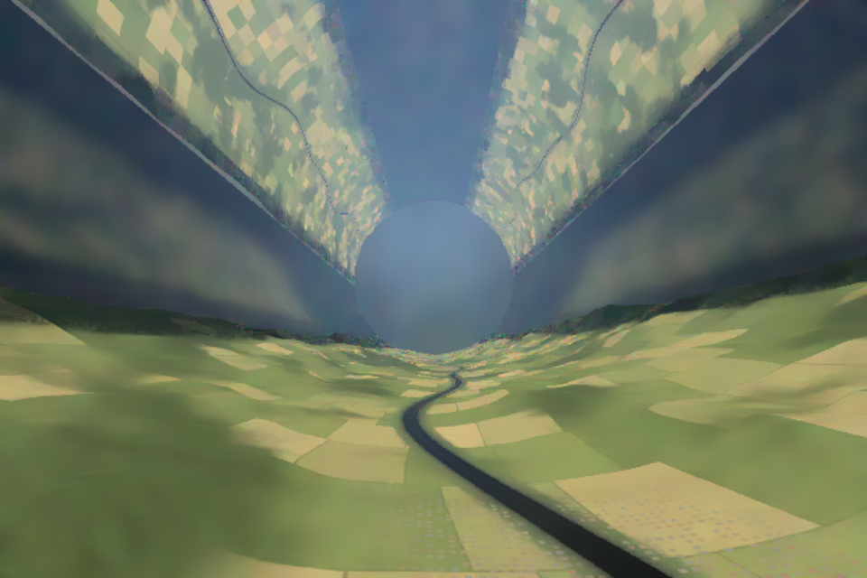

# O’Neill Atmosphere Lab

What would daylight look like inside an O’Neill cylinder? This is a browser lab
for that question: a spectral path tracer of sunlight entering a rotating,
sealed habitat through windows and mirrors, scattering in its air, haze and
clouds, plus a coarse weather model that makes those clouds. Everything runs
locally in the browser; there is no backend, CDN or analytics.



## Quick start

Needs Node.js 24+ and a browser with WebGL 2 and float render targets
(`EXT_color_buffer_float`); any recent desktop Chrome or Firefox does.

```sh
npm ci
npm run dev        # then open http://127.0.0.1:5173/
```

The first load compiles a large shader: expect 10–20 s with a cold driver
cache. Software rendering works but is slow.

## Using the lab

**Moving around.** Drag to look, scroll to fly. Click the view, then WASD to
fly, Q/E down/up, arrows to look, Shift to go faster. *Ground*, *Overlook*
and *Axis* jump to preset viewpoints; the circular arrow recenters.

While you move, a fast raster preview is shown. About 200 ms after you stop,
the path tracer takes over and the image keeps refining as long as the camera
stays still.

**The panel.**

| Tab | What it changes |
| --- | --- |
| Habitat | Size, wall gravity, window coverage, terrain, air pressure, temperature, lapse rate |
| Light | Sun direction, mirror deployment and reflectivity, glass absorption, aerosol and droplet size |
| Weather | Clouds on/off, humidity, surface heating, evaporation, wind, simulation speed, seed |
| Display | Atmosphere on/off, quality, adaptive exposure, denoising, diagnostic layers |

*Starting conditions* holds presets (clear daylight, humid afternoon, hazy,
small and giant cylinders, night, vacuum). *Copy link* puts the settings in
the URL; *Export/Import experiment JSON* saves them to a file. Both store
initial conditions and the chosen viewpoint, not evolved weather. *Save image*
exports the canvas without the interface.

**Comparing light levels.** Turn off *Adapt to scene brightness* and keep the
exposure fixed; otherwise the display rescales every view to look similar.
The **sightline luminance** readout is the physical luminance (cd/m²) of the
central pixels before any display processing.

Things worth comparing: air against vacuum, clean against hazy air, ground
against axis views, small against giant cylinders, direct sun against mirror
light, day against night.

**Quality.** *Fast*, *Balanced* (default) and *High* trace at most 0.2, 1 and
4 megapixels and upsample to the screen. All use the same physics.

**Denoising** only affects what is displayed; the light meter and saved
measurements always use the raw estimate. Turn it off in Display to see the
raw sampling noise.

## Development

| Command | What it does |
| --- | --- |
| `npm run check` | Lint, unit tests (physics, optics, Mie, weather), type check, production build |
| `npm run test:browser` | Playwright tests: shader correctness, estimator checks, interface flows |
| `npm run test:render` | The filter and cloud subset of the browser tests (seconds) |
| `npm run preview` | Serve the production build |
| `node scripts/benchmark.mjs` | Measure samples/s and UI cadence on real hardware (see below) |

Browser tests need Chromium: `npx playwright install chromium`, or set
`PLAYWRIGHT_CHROMIUM_EXECUTABLE` to an existing one. They run on SwiftShader
(software WebGL), so they check correctness, not speed. Finish editing before
starting them; hot reload interrupts running tests.

CI (`.github/workflows/ci.yml`) runs `check` and the browser tests on every
push. `image.yaml` builds the `Dockerfile`, a `scratch` image holding only the
static `dist/` build, and pushes it to the registry.

To measure performance on a real GPU, start `npm run dev`, then:

```sh
PLAYWRIGHT_CHROMIUM_EXECUTABLE=/usr/bin/chromium-browser \
  BENCHMARK_GPU_ARGS='--use-angle=gl-egl --ignore-gpu-blocklist --enable-gpu' \
  node scripts/benchmark.mjs
```

Run one renderer at a time: two browsers sharing a GPU measure each other.

## How it works

### Threads

- The **main thread** runs the interface and navigation only.
- A **render worker** owns WebGL (through an OffscreenCanvas), the light meter
  and the weather client.
- The **weather solver** runs in its own worker.
- Up to four **Mie workers** compute particle scattering tables when a particle
  size changes.

The GPU work is cut into small fenced submissions, about one per frame, so
the desktop and the interface stay responsive while the path tracer runs.

### Geometry and light sources

- A cylinder (default radius 4 km, length 24 km) with three land strips and
  three window bands. Windows have 10 m structural rings every 1.5 km.
- **Sunlight** comes from a 0.533° solar disk with a 5772 K blackbody spectrum.
  It enters directly or by way of three finite flat mirrors hinged at one
  end of the window bands. Mirror angles are fixed; moving the Sun does not
  re-aim them.
- **Panes** are thin BK7 glass plates: wavelength-dependent Fresnel reflection
  at both surfaces, repeated internal reflection, adjustable absorption.
- **Land**: procedural valleys with a river, road, fields, hedgerows,
  woodland and villages. Trees (ellipsoid crowns) and houses (gabled boxes)
  are real geometry: they cast shadows and block light, not just textures.
  Terrain height and land cover are baked into GPU atlases of up to 4096².
- **Materials** are diffuse spectra defined at 440, 550 and 680 nm (assumed,
  not measured). The river is a rough dielectric mirror over dark water.
- **Night**: settlements have 2 cd/m², 2800 K lamps; there are no stars.

### Light transport

The renderer is a Monte Carlo path tracer for the radiative-transfer
equation, working in physical units throughout.

- **Spectral.** Each path carries four wavelengths: a random "hero" and three
  companions shifted by 100, 200 and 300 nm. The hero's probabilities steer
  the path; the companions are reweighted with spectral multiple importance
  sampling (as in PBRT-v4). Results go into CIE XYZ.
- **Air** scatters by Rayleigh's law with the measured dispersion of air.
- **Haze and cloud droplets** use full Lorenz–Mie scattering tables for
  lognormal size distributions, including the sharp forward peak.
- **Media** are sampled by delta tracking; shadow rays use ratio tracking.
- **Direct sunlight** is sampled explicitly at every scattering point through
  the actual windows and mirrors (next-event estimation), combined with the
  path's own chance of hitting the Sun by multiple importance sampling.
- **Single scattering of air** along each camera ray is estimated
  separately, which removes most noise from clear-sky haze.
- **Russian roulette** ends weak paths without changing the expected result.

### Clouds: the scattered-light cache

Light in a thick cloud scatters hundreds to hundreds of thousands of times
before it leaves, which a path tracer cannot follow interactively. Clouds
therefore use a cache of the light that has already scattered at least once:

- The cache is a cylindrical grid (32 radial × 96 around × 64 along) that is
  finest near the ground and windows. Each cell stores the scattered light's
  intensity at 400, 500, 600 and 700 nm and its net direction of flow.
- **Camera paths** follow two droplet scatterings exactly, then take the
  remaining light from the cache. Direct sunlight is never cached; it is
  always sampled exactly.
- **The cache fills itself.** Each iteration traces a path from every cell,
  64 droplet scatterings long, which ends in the previous cache. Repeating
  this converges to a consistent field. The camera does not affect the cache,
  so moving around keeps it.
- **Optically deep cloud** (where light travels less than about 200 m between
  direction changes, everywhere in a cell's neighborhood) is solved with the
  diffusion equation instead. Light flows between the two regions through
  partial currents (a Marshak boundary condition).

This is an approximation; the fine angular detail of light scattered more
than twice in cloud is lost. It agrees with exact renders (see *Accuracy*)
and makes cloudy scenes about 8× faster per sample.

After a reset (new weather, a changed setting) the cache needs a few hundred
iterations, 20–40 s on a desktop GPU, to settle; until then clouds look
blotchy. Moving the camera does not reset it.

### Display

- **Denoising** is an edge-aware à-trous filter (in the style of SVGF). Light
  from visible surfaces is filtered with their texture divided out, and haze
  is filtered separately, so neither smears the other. Depth, normals,
  materials and per-pixel variance stop it at edges.
- **Exposure** adapts to the scene's measured brightness over 0.6 s
  (brightening) to 3 s (darkening). Color fades out below about 5 cd/m², a
  crude stand-in for night vision.
- **Tone mapping** is AgX (Blender/Filament constants): highlights go to
  white like film, neutrals stay neutral, black stays black.

### Weather

`WeatherSolver` is a coarse moist-convection model on a 24 × 24 × 48 grid:

- semi-Lagrangian advection and a pressure projection (incompressible flow);
- buoyancy in the centrifugal gravity field, including vapor and liquid
  water; Coriolis force;
- heating and evaporation at sunlit ground;
- saturation adjustment that conserves water and moist static energy.

Humid air condenses in the colder air near the axis. The *Humid afternoon*
preset therefore grows a central cloud from its initial conditions; it is
not drawn by hand.

### Rotating atmosphere

Spin gives wall gravity, Ω = √(g/R), and the effective height above the wall
is h(r) = (R² − r²)/2R. With a temperature lapse along h, hydrostatic balance
gives the air pressure at every radius (`backgroundAt()` in
`src/physics.ts`). At 1 g, a 4 km radius and the default 20 °C, 6.5 K/km
profile, the axis is at about 798 hPa.

## Accuracy and limits

**Validated:**

- Ratio and delta tracking reproduce Beer–Lambert transmittance, per
  wavelength (browser tests).
- Rough water conserves energy and is reciprocal (browser test).
- Four-wavelength paths agree with the earlier one-wavelength estimator in
  every image region of clear, hazy, overhead, cloudy and night scenes at 1024
  samples. At one sample per pixel, color error in clear air is 4.5× lower.
- The cloud cache was checked against exact path tracing with no event limit,
  advanced in short bounded steps:
  - extreme fog (96% humidity, 1.8 Mt of water): 405–508 cd/m² against
    418 ± 53 cd/m²; the capped exact renderer showed about 40 cd/m², because
    most light there needs far more than 1024 scattering events;
  - Humid afternoon: within about 10% of the exact camera estimator, at 7.7×
    its speed (12.7 against 1.6 samples/s at 480 × 360);
  - uniform fog of 30/km, without deep cells: converges slowly and noisily,
    3300–4400 cd/m² after two minutes in two runs, against 3495 ± 217 cd/m².
- The droplet phase function is sampled with its own normalized value as the
  density. Differencing the float32 CDF instead multiplied rare paths' weights
  by about 10⁸, which showed up as fireflies.

**Assumed:** material spectra; constant refractive indices for aerosol (1.50 +
0.01i) and water (1.333); procedural trees and houses; a smooth solar spectrum
without absorption lines or limb darkening.

**Not modeled:** polarization, atmospheric refraction, non-spherical
aerosols, measured surface reflectance (BRDFs), glass thickness, stars, rain
or ice.

**Numerical limits:** cloud-free paths stop after 64 events and cloud paths
after 1024; the cloud cache approximates high-order scattering; weather is a
coarse Boussinesq model, not a climate model. Treat numbers as
illustrations, not habitat predictions.

## Code map

| Path | Contents |
| --- | --- |
| `src/settings.ts` | Parameters and presets |
| `src/physics.ts`, `src/optics.ts` | Hydrostatics, thermodynamics, window, glass and mirror geometry |
| `src/weather/` | Moist solver and its worker |
| `src/render/renderer.ts` | GPU passes: tracing bands, accumulation, cloud cache, display |
| `src/render/cache.ts` | Cloud cache grid and diffusion coefficients |
| `src/render/shaders/transport.glsl` | The path tracer |
| `src/render/shaders/cache.glsl`, `cache-diffusion.glsl` | Cache lookup and deep-cloud diffusion solve |
| `src/render/shaders/landscape.glsl`, `surface.glsl`, `geometry.glsl` | Terrain, land use, trees, houses, materials, glass |
| `src/render/shaders/denoise.glsl`, `tonemap.glsl` | Display filter and tone mapping |
| `src/render/mie.ts`, `particles.ts` | Mie tables and their workers |
| `src/render/preview.ts` | Raster navigation preview and atlas bakes |
| `src/render/worker.ts`, `client.ts` | Render worker and its main-thread client |
| `src/ui/` | Controls, settings import and model notes |
| `tests/` | Unit tests (`*.test.ts`) and browser tests (`browser/`) |

## References

- PBRT-v4: [volume scattering integrators](https://www.pbr-book.org/4ed/Light_Transport_II_Volume_Rendering/Volume_Scattering_Integrators) (spectral MIS, delta and ratio tracking) and [dielectric BSDF](https://www.pbr-book.org/4ed/Reflection_Models/Dielectric_BSDF).
- Wilkie et al., [Hero Wavelength Spectral Sampling](https://doi.org/10.1111/cgf.12419), 2014.
- Prahl, [Mie scattering algorithms](https://miepython.readthedocs.io/en/stable/07_algorithm.html).
- Wyman, Sloan & Shirley, [CIE XYZ fits](https://jcgt.org/published/0002/02/01/).
- [SCHOTT N-BK7 data](https://media.schott.com/api/public/content/41e799d0bf874807a0bb8e702fbb75b5?v=54856406); [NIST refractive index of air](https://emtoolbox.nist.gov/wavelength/documentation.asp).
- Bruneton & Neyret, [Precomputed Atmospheric Scattering](https://ebruneton.github.io/precomputed_atmospheric_scattering/).
- Reinhard et al., [Photographic Tone Reproduction](https://www-old.cs.utah.edu/docs/techreports/2002/pdf/UUCS-02-001.pdf); Ferwerda et al., [A Model of Visual Adaptation](https://www.graphics.cornell.edu/pubs/1996/FPSG96.pdf).
- [NCAR Community Atmosphere Model](https://www.cesm.ucar.edu/models/atm-cam/docs/description/description.pdf), for context on the weather model's much simpler physics.
